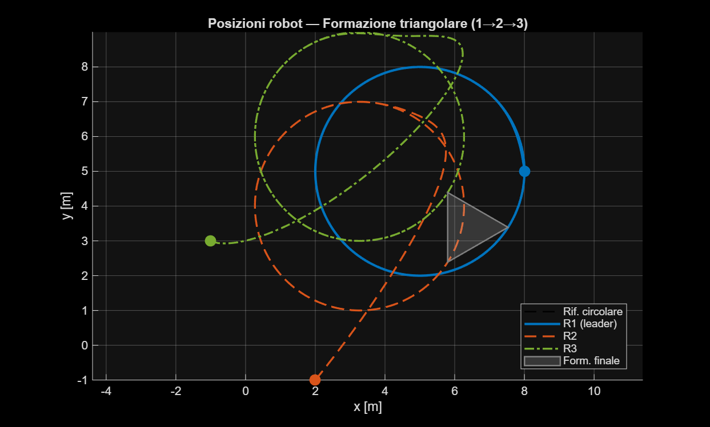
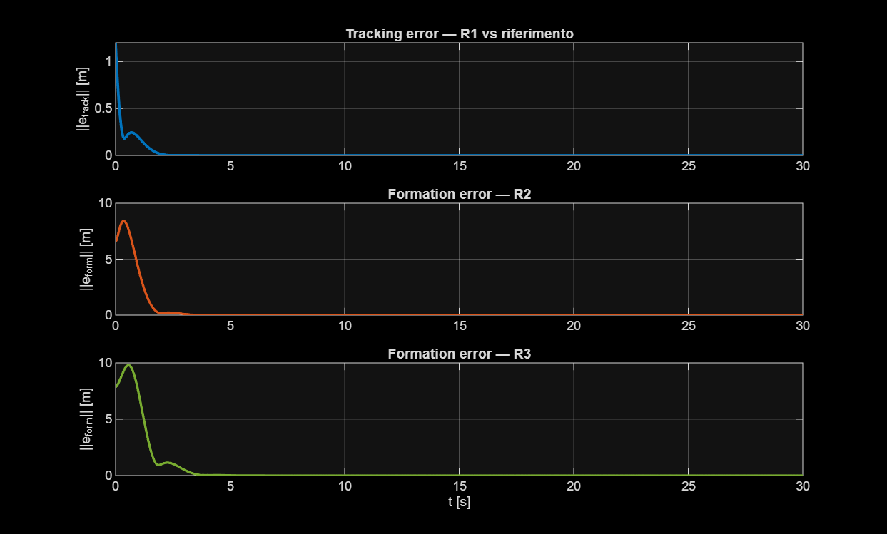
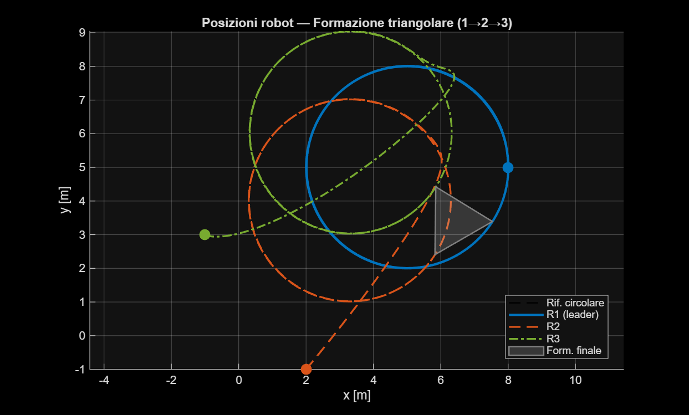
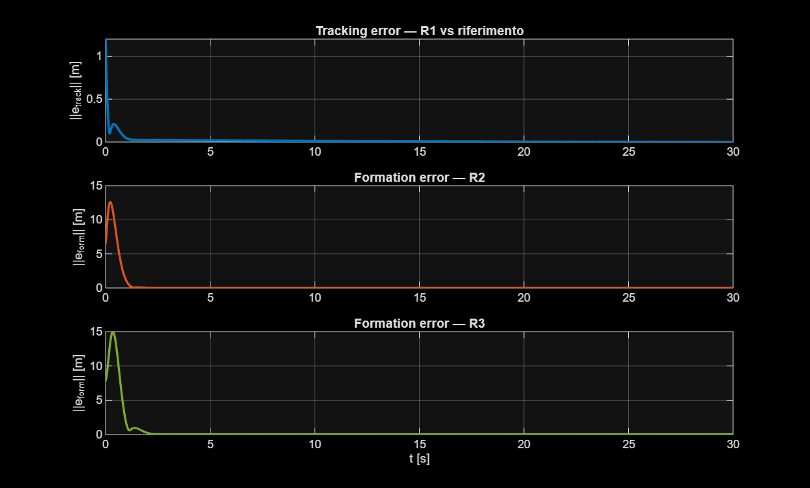

# Multi-Agent Cyber-Physical System Simulator

Decentralized formation control simulator for a team of heterogeneous, nonlinear planar mobile robots. Developed as the final project for the *Modeling and control of cyber-physical systems* course at Politecnico di Torino.

## 📌 Project Overview
The primary goal is to govern the movement of planar mobile robots to achieve and maintain a specific moving target configuration (a triangular formation)[cite: 7]. Since the agents are heterogeneous, they exhibit different dynamic behaviors[cite: 7]. The proposed approach tackles this complexity through a two-phase architecture:
1. **Local Input-Output Feedback Linearization:** Mathematical cancellation of the specific nonlinearities of each individual agent, transforming their distinct dynamics into a common, standardized linear double-integrator model[cite: 7].
2. **Distributed Control:** Aggregation of the unified models to formulate the global dynamics of the linear multi-agent system, defining a communication graph topology to drive the network toward the target configuration[cite: 7].

## ⚙️ Phase 1: Feedback Linearization (FL)
Each agent is characterized by the following nonlinear affine model[cite: 7]:

$$\dot{p}_i = v_i$$
$$\dot{v}_i = \phi_i(p_i, v_i) + B_i(p_i, v_i)u_i$$

Where $\phi_i$ represents the drift term and $B_i$ is the decoupling matrix[cite: 7]. The vector relative degree is $(r_x, r_y) = (2, 2)$, meaning the system has no zero dynamics[cite: 7]. 

The decoupling matrices were verified for non-singularity. For instance, Agent 3 presents a nonlinear coupling defined by[cite: 7]:

$$det(B_3) = (1 + 0.2 \cos^2(p_{y,3}))(1 + 0.2 \sin^2(p_{x,3})) - 0.0064 \sin(p_{x,3})\sin(p_{y,3}) \geq 0.9936 > 0$$

The globally valid feedback-linearizing control law is defined as[cite: 7]:

$$u_i = B_i(p_i, v_i)^{-1} [\nu_i - \phi_i(p_i, v_i)]$$

This transformation yields a unified double-integrator model for all agents[cite: 7]: $\ddot{y}_i = \nu_i$.

## 🌐 Phase 2: Global Dynamics & Topology
The communication topology is designed as a directed chain ($1 \rightarrow 2 \rightarrow 3$), where Agent 1 acts as the formation leader[cite: 7]. The network is mathematically characterized by its in-degree Laplacian matrix[cite: 7]:

$$\mathcal{L} = \begin{bmatrix} 0 & 0 & 0 \\ -1 & 1 & 0 \\ 0 & -1 & 1 \end{bmatrix}$$

A pinning control strategy is implemented, meaning the external reference trajectory data is exclusively injected into the leader via the pinning matrix $P_{in} = diag(1, 0, 0)$[cite: 7]. The distributed state error for each agent, incorporating the rigid triangular formation offsets $H_i$, is computed as[cite: 7]:

$$\epsilon_i = \sum_{j=1}^{3} \mathcal{A}_{ij} [(x_j - x_i) - (H_j - H_i)]$$

## 🛠 Decentralized Controller Design
Two main distributed control protocols were evaluated to synthesize the virtual acceleration commands $\nu_i$:

1. **State-Feedback Protocol:** An optimal control approach relying on the Algebraic Riccati Equation (ARE) to compute the feedback gain matrix $K$[cite: 7]. While effective in nominal scenarios, robustness analysis demonstrated severe vulnerability to persistent external disturbances[cite: 7].
2. **Loop-Shaping Protocol (PID/PD):** A transition to the frequency domain using dynamic output-feedback compensators $K(s)$[cite: 7]. The integration of a PID controller, with an integral action anchored at the leader node, successfully rejected low-frequency unmeasured disturbances and maintained strict geometric rigidity[cite: 7].

## 📊 Experimental Results

### Nominal Scenario (State-Feedback)
The agents successfully achieved the rigid triangular geometry while tracking a circular reference trajectory[cite: 7].

  
  

### Disturbance Rejection (Loop-Shaping)
Under combined sensor noise and persistent external constant disturbances, the dynamic PID compensator successfully absorbed the geometric dislocation and maintained formation stability[cite: 7].

  
  

## 🚀 How to Run
1. Clone the repository: `git clone https://github.com/alex-martinelli/multi-agent-cps-simulator.git`
2. Open MATLAB and navigate to the project directory.
3. Open the main Simulink model `multiagents.slx`.
4. Execute the simulation to observe the position plots and formation error graphs under various disturbance conditions.
